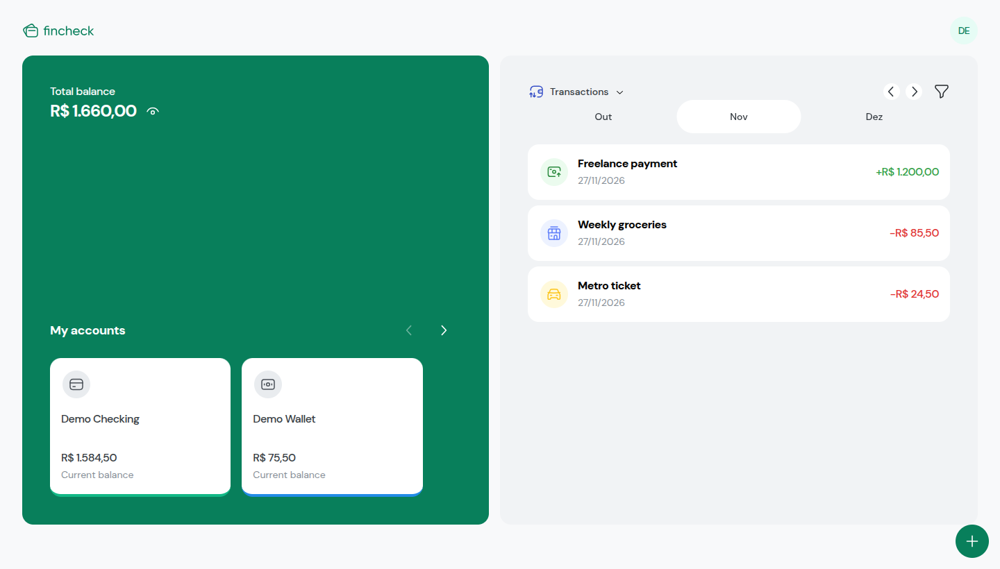
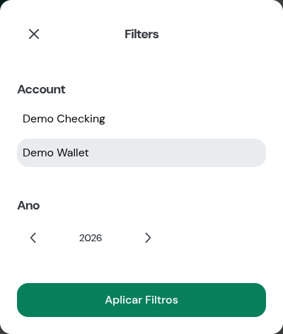
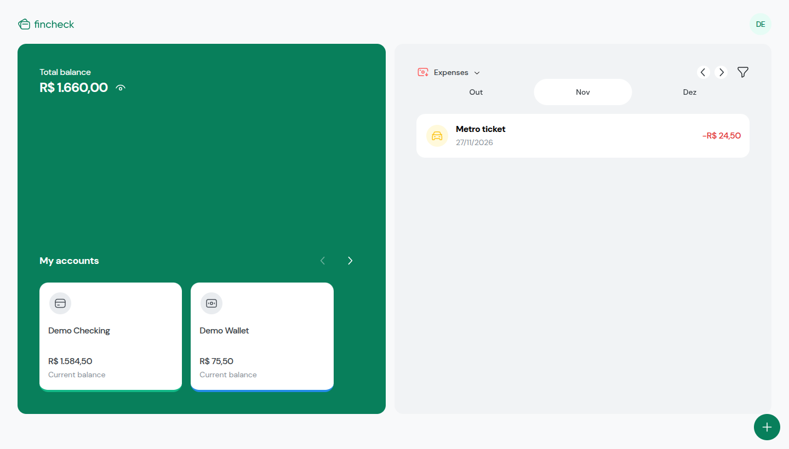
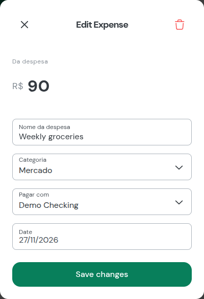
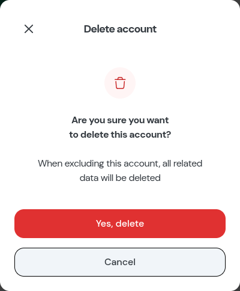
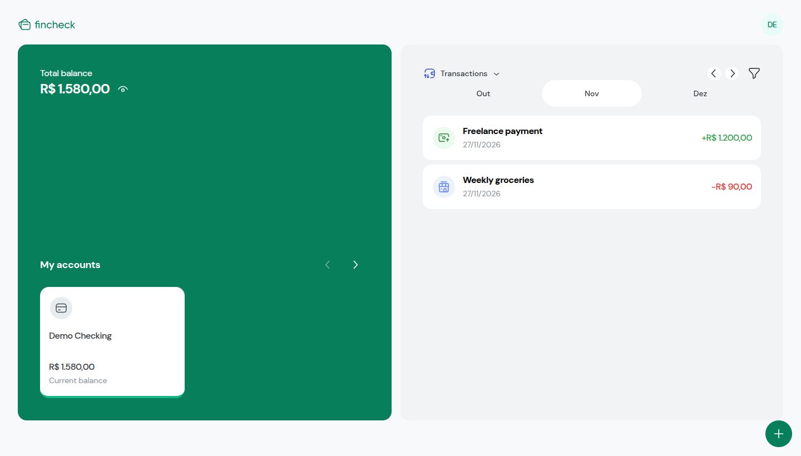

# Fincheck

Fincheck is a personal finance tracker for bank accounts, income, and expenses. It includes a React dashboard and a NestJS API backed by PostgreSQL.

## Demo: manage accounts and transactions

This Chrome run used the local API and PostgreSQL with fictitious data. The dashboard started with **R$ 600,00** across a checking account and a cash account. A freelance payment and three expenses brought the total to **R$ 1.660,00**. The November list shows three entries because the transit pass was dated in October.



| Workflow | Observed result |
| --- | --- |
| Register, sign out, and sign in | The account and its remaining transactions were still present after signing back in and reloading. |
| Create and rename accounts | Created **Demo Checking** and **Demo Wallet**. Renaming the wallet to **Daily Cash** preserved its **R$ 100,00** opening balance and **R$ 75,50** current balance. |
| Add income and expenses | Recorded a **R$ 1.200,00** receipt and categorized expenses. The new expense form returned to today's date after a backdated entry. |
| Filter transactions | **Receipts** showed only the payment. **Expenses** with **Demo Wallet** selected showed only the metro ticket. Switching months showed the October pass, and selecting 2025 showed an empty list. |
| Edit and delete records | Changing **Weekly groceries** from **R$ 85,50** to **R$ 90,00** reduced the total to **R$ 1.655,50**. Deleting the metro ticket restored **R$ 24,50**. Deleting the cash account also removed its remaining parking expense from the list. |
| Hide and reveal amounts | The eye control hid the amounts and remembered that preference after a reload. |

<details>
<summary>Filter expenses by account and date</summary>





</details>

<details>
<summary>Edit an expense and delete a sample account</summary>







</details>

## Prerequisites

- Node.js 24 and npm (the demo used Node.js 24.11.0).
- A local PostgreSQL database. The demo used a standalone PostgreSQL instance. The command below shows the Docker setup.

## Environment variables

| File | Variable | Purpose |
| --- | --- | --- |
| `api/.env` | `DATABASE_URL` | PostgreSQL connection URL for Prisma. |
| `api/.env` | `JWT_SECRET` | Local signing secret. Replace the example placeholder with a generated value. |
| `frontend/.env` | `VITE_API_URL` | API base URL, `http://localhost:5000` for this setup. |

## Run locally

From the repository root, start PostgreSQL. The credentials here are for a disposable local database.

```bash
docker run -d --name fincheck-db -p 127.0.0.1:5432:5432 \
  -e POSTGRES_USER=fincheck -e POSTGRES_PASSWORD=fincheck \
  -e POSTGRES_DB=fincheck postgres:16
```

In the API terminal, copy the example and replace the signing secret in the copy. If you use another database, update `DATABASE_URL` to match.

```bash
cd api
cp .env.example .env
node -e 'console.log(require("node:crypto").randomBytes(32).toString("hex"))'
# Set JWT_SECRET in .env to the generated value.
npm ci
npx --no-install prisma migrate deploy
npx --no-install prisma generate
npm run start:dev
```

In a second terminal, from the repository root:

```bash
cd frontend
cp .env.example .env
npm ci
npm run dev -- --host 127.0.0.1
```

To use the same production preview as the screenshots, run `npm run build` and then `npm run preview -- --host 127.0.0.1 --port 3001` from `frontend`.

## Reproduce the demo

1. Open [the sign-up page](http://127.0.0.1:3000/register), or use port 3001 for the production preview. Register a sample user, such as `demo@example.test`.
2. Select **Register a new account**. Create **Demo Checking** as a **Checking account** with an opening balance of **R$ 500,00**. Use **+ → New Account** to create **Demo Wallet** as **Cash** with **R$ 100,00**. Pick a different color for each account.
3. Use **+ → New Recipe** to add income and **+ → New Expense** to add expenses. Enter the sample records below and check that the total reaches **R$ 1.660,00**. If values are blurred, click the eye next to **Total balance**.

| Transaction | Amount | Category | Account | Date |
| --- | --- | --- | --- | --- |
| Freelance payment | +R$ 1.200,00 | Freelance | Demo Checking | Today |
| Weekly groceries | −R$ 85,50 | Mercado | Demo Checking | Today |
| Metro ticket | −R$ 24,50 | Transporte | Demo Wallet | Today |
| October transit pass | −R$ 30,00 | Transporte | Demo Checking | The 10th of the previous month |

4. Switch **Transactions** to **Receipts**, then **Expenses**. Open the funnel menu, select **Demo Wallet**, and click **Aplicar Filtros**. The current month shows only **Metro ticket**. Clear the account filter by selecting the wallet again. Test a year with no records, then select the appropriate year and month to find the transit pass. Reset the view to **Transactions** in the current month before continuing.
5. Open **Weekly groceries**, change its amount to **R$ 90,00**, and save. Click **Demo Wallet**, rename it **Daily Cash**, and save without changing its **Opening balance**.
6. Open **Metro ticket**, click the trash icon, and confirm. Add a **R$ 10,00** **Parking sample** expense to **Daily Cash** with today's date. Then open the **Daily Cash** account and use its trash icon to delete the sample account. Confirm that both the account and parking expense disappear and the total is **R$ 1.580,00**.
7. Hide the amounts, reload, and check that they are still hidden. Reveal them, choose **Sair** in the profile menu, and sign back in. **Demo Checking**, **Freelance payment**, and the edited **Weekly groceries** remain on the dashboard.

## Attribution

Built during the [JStack](https://jstack.com.br/) course.
